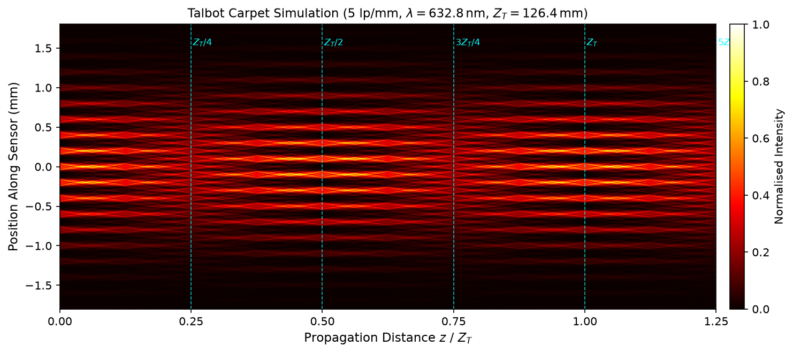
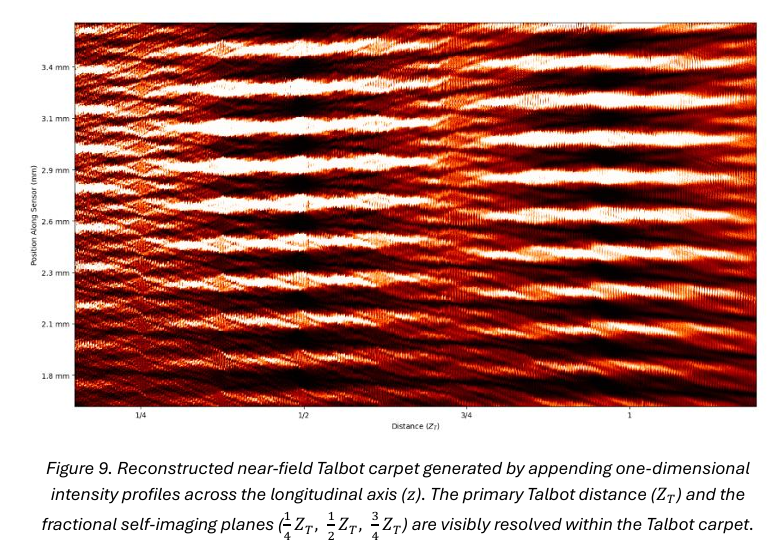

# Quantum Interferometry: Near-Field & Far-Field Optical Wavefront Analysis

[](https://www.python.org/downloads/)
[](https://opensource.org/licenses/MIT)

An experimental and computational study investigating Fraunhofer far-field diffraction, macroscopic Heisenberg uncertainty complementarity, and Fresnel near-field Talbot self-imaging using a continuous 633 nm Helium-Neon (HeNe) laser bench[cite: 1, 3, 8].

Authored by **Joseph Nasrollahzadeh**, School of Physics & Astronomy, University of Nottingham[cite: 1].

---

## Key Experimental & Engineering Highlights

* **Optomechanical Alignment & Beam Expansion:** Designed a custom Keplerian telescope using 50 mm plano-convex and 125 mm convex lenses (175 mm separation) to expand the 633 nm beam[cite: 9, 10]. This prevented boundary-aperture clipping and established uniform phase illumination across the 5 lines/mm diffraction grating[cite: 5, 8, 10].
* **Systematic Hardware Offset Diagnosis:** Isolated an internal 1.82 cm mechanical recess offset within the CCD sensor housing that initially skewed measured Talbot distances by 14%[cite: 1, 10, 14]. Applying this hardware correction yielded an empirical primary self-imaging distance of $Z_T = 12.60\text{ cm}$, matching theoretical predictions ($12.64\text{ cm}$) to within **0.4%**[cite: 1, 14, 15].
* **Automated Data Processing Pipeline:** Built Python data pipelines (NumPy, SciPy) utilising 1D Gaussian smoothing filters ($\sigma = 3$) and automated peak-detection algorithms to extract intensity nulls and construct 2D Talbot carpets from longitudinal translation sweeps[cite: 18, 19, 24, 25].
* **Heisenberg Uncertainty Boundary Verification:** Quantified transverse momentum-position uncertainty gradients across variable aperture widths ($0.2\text{ mm}$ to $0.8\text{ mm}$), yielding a linear slope of $(1.82 \pm 0.17) \times 10^{-33}\text{ kg m}^2\text{s}^{-1}$ with propagated error bounds[cite: 1, 8, 11, 13].

---

## Theory vs Empirical Reconstruction

| Forward Numerical Simulation (Angular Spectrum) | Empirical Reconstruction (Longitudinal CCD Sweep) |
| :---: | :---: |
|  |  |
| *Exact non-paraxial angular-spectrum propagation[cite: 5]* | *Automated centroid tracking & row stacking[cite: 24, 25]* |

---

## Repository Structure

```text
Quantum-Interferometry/
├── notebooks/
│   └── interactive_talbot.ipynb       # Interactive parameter sliders (wavelength, grating period)
├── paper/
│   └── Quantum_Interferometry_In_The_Optical_Near_And_Far_Field.pdf  # Authored 24-page report[cite: 1]
├── src/
│   ├── A_single_slit_diffraction.py   # Appendix A: Fraunhofer single-slit peak extraction[cite: 18]
│   ├── B_heisenberg_uncertainty.py    # Appendix B: Momentum uncertainty & error propagation[cite: 20]
│   ├── C_grating_sinc_fit.py          # Appendix C: Multi-slit interference & sinc² envelope[cite: 22]
│   ├── D_talbot_carpet.py             # Appendix D: Near-field 2D carpet reconstruction[cite: 24]
│   └── simulate_carpet.py             # Forward wave simulation (angular-spectrum method)
├── assets/
│   ├── simulated_carpet.png           # Simulation output figure
│   └── reconstructed_carpet.png       # Experimental carpet output figure[cite: 14]
├── demo.py                            # Standalone demonstration & verification runner
├── requirements.txt                   # Dependency environment specification
├── .gitignore
├── LICENSE
└── README.md
```

---

## Quickstart

### 1. Installation
Clone the repository and install dependencies:

```bash
git clone [https://github.com/joenasrollah/optical-interferometry-metrology.git](https://github.com/joenasrollah/optical-interferometry-metrology.git)
cd optical-interferometry-metrology
pip install -r requirements.txt
```

### 2. Run the Verification Demo
Run the root demonstration script to simulate the Talbot carpet and verify the 1.82 cm sensor casing calibration[cite: 1, 10, 14]:

```bash
python demo.py
```

### 3. Interactive Notebook
To explore the non-paraxial propagation model interactively:

```bash
jupyter notebook notebooks/interactive_talbot.ipynb
```